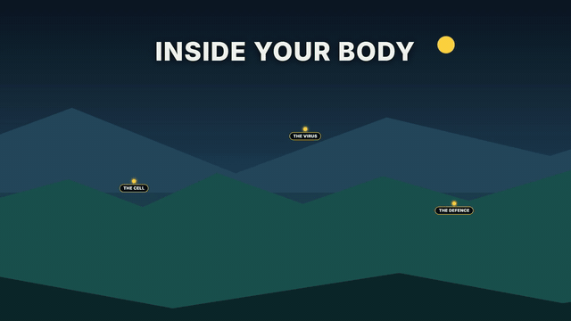
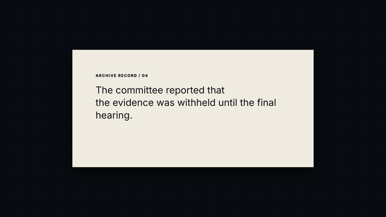

# hf-kit

[](https://ko-fi.com/jju1s)

Blocks and presets for [HyperFrames](https://github.com/heygen-com/hyperframes) 0.8.77, built from measurements of 48 YouTube videos in 16 niches.

<p>
  
  
</p>

All 13 blocks play on the [project page](https://cig13zs.github.io/hf-kit/). There is also a [reel](docs/media/reel.mp4).

Each niche is one creator: two of their outlier videos (the most views relative to the channel's median) and one ordinary video as a control. For each video we measured cuts per minute by segment, shot lengths, on-screen text share, words per minute, loudness, silences and music onsets. What came out of that:

- 16 style files holding the measured ranges (`styles/`)
- 13 HyperFrames blocks, each rebuilding one technique from a niche's steal list (`blocks/`, with a demo per block in `examples/`)
- 10 mix presets, 11 generated sound effects and 7 generated mood beds (`sound/`)
- a caption generator, a project scaffold, a licence gate for Creative Commons footage on YouTube, and a checker that measures your render against a style (`tools/`)
- the research itself: 48 video cards, 16 niche sheets, a technique library with a mood table, and three reference chapters (`research/`)

The result worth knowing before you use any of it: cut rate and loudness did not separate the outliers from their controls. A person with something at stake, the stake stated in the first seconds, proof on screen and an answer held back did. Those are hypotheses from three videos per creator.

## Install

```sh
git clone https://github.com/cig13zs/hf-kit
cd hf-kit
pip install numpy pillow pytesseract
```

You also need Node for HyperFrames (`npx hyperframes@0.8.77` works, so does a local install of 0.8.77) and `ffmpeg` with `ffprobe` on your PATH. The Python tools want 3.10 or newer. `yt-dlp` is only needed for the footage gate and for measuring new videos. The checker imports `research/measure.py`, which imports `pytesseract`; the Tesseract program itself only runs when you measure a new video's on-screen text.

### As an agent skill

`skills/hf-kit/SKILL.md` teaches a coding agent the workflow below. Copy `skills/hf-kit/` into `~/.claude/skills/` for Claude Code or `~/.codex/skills/` for Codex, and start the agent inside the clone, since the skill's paths are relative to the repo root. It expects the HyperFrames skills to be installed too.

## Workflow

1. Pick a style in [`styles/README.md`](styles/README.md) and scaffold a project with its tokens and blocks. The scaffold refuses to write into a folder that isn't empty.

   ```sh
   python tools/scaffold.py my-short --format 9:16 --duration 40 --style facts-short
   ```

2. Render a mood bed at the length you need, then paste a preset from [`sound/MIX.md`](sound/MIX.md) into `index.html`. Sound effects are already in `sound/sfx/`; [`sound/SFX.md`](sound/SFX.md) maps events to files and levels. `python sound/gen_bed.py` with no arguments writes all 7 beds as 32-second loops into `sound/beds/`. The moods are `calm-pad`, `wonder-pad`, `tension-drone`, `hype-pulse`, `story-noir`, `news-tick` and `kids-bounce`.

   ```sh
   python sound/gen_bed.py --mood tension-drone --seconds 40 --out my-short/assets/bed.wav
   ```

3. Turn word timings into a caption sub-composition, then host it in `index.html` the way the scaffold hosts a block. Input is `[{"text", "start", "end"}]` (with optional `speaker` and `class`) or the JSON that `hyperframes transcribe` writes. Variants: `cards`, `karaoke`, `speaker`, `keyword`, `punch`.

   ```sh
   python tools/captions.py words.json --variant cards --format 9:16 --out my-short/compositions/captions.html
   ```

4. If you want background footage or music from YouTube, run it through the licence gate first. It downloads only when yt-dlp reports a Creative Commons licence (exit 0, and it prints a credit line for your description). A "no copyright" claim in a title gets REVIEW (exit 3) and no download. Anything else is REFUSE (exit 2). Video needs at least 1080p unless you change `--min-height`; add `--audio` to take only the sound. Every decision is appended to `sources/provenance.jsonl`.

   ```sh
   python tools/bg_source.py "https://www.youtube.com/watch?v=VIDEO_ID" --download --out my-short/assets
   ```

5. Lint and render. Running `npx hyperframes@0.8.77 preview` inside `my-short` opens it in HyperFrames Studio first, if you want to scrub through it.

   ```sh
   npx hyperframes@0.8.77 lint my-short
   npx hyperframes@0.8.77 render my-short --output out.mp4
   ```

6. Measure the render against the style. You get cuts per minute for each segment, median shot, loudness range, silences per minute and first spoken word (when a `words.json` or `.srt` sits next to the video), each compared with the style's range. A last line checks the master against -14 LUFS and -1 dBTP. The script always exits 0; your own analytics decide whether a miss matters.

   ```sh
   python tools/check.py out.mp4 --style facts-short
   ```

## Blocks

Every block is a HyperFrames sub-composition. Colours and fonts come from `--hk-*` tokens, so a style themes all of them at once, and text and timing are variables. Variables and hosting details are in [`blocks/README.md`](blocks/README.md).

| Block | Demo | Niche | Steal-list row |
|---|---|---|---|
| `world-camera` | 16:9 | animated-explainer | Long take through one world |
| `pill-label` | 16:9 | animated-explainer | Pill label on first appearance |
| `chapter-card` | 16:9 | animated-explainer | Spoken chapter card |
| `ui-window` | 16:9 | animated-explainer | UI window as evidence |
| `doc-highlight` | 16:9 | documentary | Highlighted source document |
| `film-gate` | 16:9 | documentary | Film-gate archive look |
| `number-card` | 16:9 | tech-review, challenge-spectacle | Numbers as cards, nothing else; Outlined money type |
| `progress-badge` | 16:9 | challenge-spectacle | One progress device |
| `tier-board` | 16:9 | cooking | Scoring spine carried to a champion |
| `zoom-through` | 9:16 | shorts-facts | Camera-move joins over hard cuts |
| `blur-swap` | 9:16 | shorts-vfx | One-take look; Transformation on camera |
| `face-banner-stack` | 9:16 | shorts-gaming | Face-banner-content stack |
| `question-card` | 9:16 | shorts-podcast | Question card over a stacked split |

`question-card` and `face-banner-stack` are 9:16 only, `world-camera` and `tier-board` are 16:9 only. The rest size themselves to either.

## Styles

A style is one creator's three videos boiled down to ranges, plus the tokens, caption variant, blocks and mix presets that fit them. Full table with blocks and mix presets: [`styles/README.md`](styles/README.md).

| Style | Niche | Measured from | Format | Captions |
|---|---|---|---|---|
| `archive-essay` | documentary | Johnny Harris | 16:9 | none |
| `world-explainer` | animated-explainer | Kurzgesagt | 16:9 | none |
| `build-payoff` | science-entertainment | Mark Rober | 16:9 | none |
| `challenge-metronome` | challenge-spectacle | MrBeast | 16:9 | punch |
| `proof-review` | tech-review | Marques Brownlee | 16:9 | none |
| `screen-news` | tech-news-screen | Fireship | 16:9 | punch |
| `series-gameplay` | gaming-longform | Grian | 16:9 | none |
| `campfire-story` | storytelling-true-crime | MrBallen | 16:9 | none |
| `tasting-tour` | cooking | Joshua Weissman | 16:9 | keyword |
| `block-lesson` | kids-education | Numberblocks | 16:9 | none |
| `calm-teaching` | calm-faith | BibleProject | 16:9 | none |
| `drawn-storytime` | animated-storytime | JaidenAnimations | 16:9 | none |
| `facts-short` | shorts-facts | Zack D. Films | 9:16 | cards |
| `news-short` | shorts-gaming | KreekCraft | 9:16 | karaoke |
| `podcast-clip` | shorts-podcast | The Diary Of A CEO | 9:16 | speaker |
| `one-take-trick` | shorts-vfx | Zach King | 9:16 | cards |

The [project page](https://cig13zs.github.io/hf-kit/#styles) has the cut-rate ranges by segment for all 16.

## Research

Start with [`research/TECHNIQUES.md`](research/TECHNIQUES.md). It pulls the 16 niche sheets together into one technique library, and its section 0, "What didn't separate outliers from controls", is the part to read before you copy anyone's pace. The library ends with a mood table (cut rate, shot length, music, SFX, colour and easing for dread, tension, curiosity, wonder, hype and the rest).

The sample is in [`research/SAMPLE.md`](research/SAMPLE.md). For each creator we took their latest 80 uploads and picked the video with the highest views-to-median ratio, the highest ratio among the latest 30, and the video closest to the median among the latest 30 as the control. Compilations, sponsored uploads, livestreams and anything over two hours were skipped. Outlier ratios run from 1.62x to 44.32x, controls from 0.93x to 1.08x. Views were read on 2026-09-26.

What the comparison showed, with the numbers from `research/data/`:

- Overall cut rate went both ways. Outliers cut slower than their own control in 4 niches and faster in 4, and each faster case has a confound. Johnny Harris's outliers run 14.6 to 14.8 cuts per minute against 23.4 for the control.
- Integrated loudness ranged from -5.6 to -33.9 LUFS across the 48 videos with no pattern between outliers and controls. The kit masters to -14 LUFS and -1 dBTP.
- 15 of the 16 niches use no whip, glitch, spin or zoom transition as a habit.
- Short silences are the most shared sound device, found in 12 of 16 niches. They sit before reveals and after the heaviest lines.
- The things that recurred in outliers: a person with something at stake (6 niches), the stake or claim in the first seconds (6), proof on screen (5), the title's answer held back (4), denser speech in the first 30 seconds (8) and fewer music-only stretches (8).

Where the rest lives:

| What | Path |
|---|---|
| One sheet per niche: ranges, house devices, outlier against control, steal list | [`research/niches/`](research/niches/) |
| One card per video | `research/cards/<niche>/<video-id>.md` |
| Raw measurements per video | `research/data/<video-id>.json` |
| Reference chapters: music and mood, sound design, VFX and motion | [`research/knowledge/`](research/knowledge/) |
| The measuring scripts | `research/measure.py`, `research/audio_features.py`, `research/sample.py` |

To measure another video the same way: `python research/measure.py "<url>" --niche <name> --role outlier`, then `python research/audio_features.py <video-id>`. Both need `yt-dlp`, and `measure.py` needs Tesseract for the text share.

## Limits

Hard-cut counts are floors. The detector counts an ffmpeg scene score of 0.30 or more, so dissolves, whips, camera moves and overlays go uncounted, and game menus add false cuts. That is why `series-gameplay` and `calm-teaching` carry no cut-rate targets.

Every niche is one channel, so every "niche" finding is really one creator's house style, measured on three videos.

Nobody listened to the audio. The sound findings come from loudness, spectrum, onset timing and the `[music]` tags in YouTube captions. Onsets per minute mostly count syllables, and tempo estimates under narration were too unstable to use.

Outlier against control is a comparison of three videos, and views don't prove the edit caused them. Some pairs have obvious confounds, listed in section 0 of TECHNIQUES.md (a launch-week product, two first episodes, an hour-long compilation, a control from a different sub-format).

The on-screen text share comes from OCR on sampled frames and undercounts stylised captions.

## Licence

MIT, see [LICENSE](LICENSE). The generated audio (the files in `sound/sfx/` and any bed you render with `sound/gen_bed.py`) is CC0. The research refers to the 48 videos by ID and link; their frames, audio and transcripts are not in this repo.
